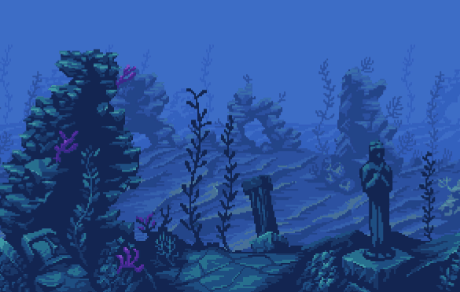

# Krillion Answer Database

> Complete archive of Krillion's graded answers, with instant search for the rare 100-point ones.

[](#final-tally)
[](https://berliandro.github.io/krillion-answer-database/)

This repo collects the graded answers from [Krillion Unlimited](https://playdaily.org/krillion) and makes them searchable while you play. Answers are graded across six tiers, from Plankton (10 points) to **One in a Krillion** (100 points); only the top tier is flagged `is_krillion: true`.

It started as a way to help a friend chase a high score. The scrape ran until the prompt bank was exhausted, and the result is a complete answer archive with a small, fast search index on top. Unofficial; not affiliated with Daily Games.



## Quick start

Use the [public search](https://berliandro.github.io/krillion-answer-database/) in a browser — no setup needed. To run it locally:

```powershell
python scripts/krillion_db.py init
python scripts/krillion_db.py import
python webapp/app.py
# open http://127.0.0.1:8765
```

`import` also reads `injection/data/corrections.jsonl` (append-only demotions from the gameplay bridge) and sets `is_krillion = 0` on matching `(question, answer)` rows *before* rebuilding, so a demoted answer disappears from the rare-answers site. The injection bridge itself is read-only against both DBs.

Search with `python scripts/krillion_db.py search "fictional bear"`. Rebuild the Search DB with `python scripts/krillion_db.py rebuild`. Build the krillion-only DB and its second website with:

```powershell
python scripts/krillion_db.py krillion-only
python scripts/build_krillion_site.py
```

The public site is fully static: `index.html` loads `search-data.json` and searches in the browser. Regenerate the snapshot after importing answers:

```powershell
python scripts/build_static.py
python scripts/build_krillion_site.py
python scripts/build_webapp.py
git add site-template.html index.html search-data.json krillion/index.html krillion/krillion-data.json webapp/index.html
git commit -m "Refresh static search index"
git push
```

GitHub Pages rebuilds from `main` within about a minute. The snapshot is about 130 KB raw (~35 KB gzipped) at 2,509 questions.

## How it works

| Store | Contains | Purpose |
| --- | --- | --- |
| Full DB | Every answer to every prompt, with tier and source | Source of truth |
| Search DB | One answer per question | What the all-answers site reads |
| Krillion-only DB | Only the 17,876 One-in-a-Krillion answers | Source for the second site |

The Search DB keeps the "One in a Krillion" answer when available, otherwise the shortest one. It is rebuilt from the Full DB after each import.

## One file to edit

`site-template.html` is the single source of truth for layout, palette, typography, motion, matte finish, responsive rules, and the shared search/copy/onboarding code. The three built pages differ only by a small config in the builder scripts:

| Built page | Site | Builder | Mode |
| --- | --- | --- | --- |
| `index.html` | all-answers search (one answer per question) | `scripts/build_static.py` | `lookup` |
| `krillion/index.html` | all One-in-a-Krillion answers, grouped by prompt | `scripts/build_krillion_site.py` | `vault` |
| `webapp/index.html` | local webapp shell (uses `/api/search`) | `scripts/build_webapp.py` | `local` |

Edit the template, then run all three builders. The two websites remain separate pages with separate data files; only their shared design and code come from the one HTML file. Page-specific CSS stays as a small `VAULT_CSS` string in its builder.

The switch button in both public pages swaps views without navigation: each dataset is fetched once and cached in memory, the URL changes with `history.pushState`, and Back/Forward works without a reload. Returning to a previously visited view renders from cache with no network request.

## Paraphrase-tolerant search

Krillion's bank contains near-duplicate prompts as *distinct games* (`Name a Mario character` vs `Name a character from Mario`), and players often type a slightly different wording (`Name any one famous park` vs the stored `Name a famous park`). The old search scored literal substrings, so such input could return nothing or the wrong answer — the site's own placeholder was one such failing query. The game itself renders its prompt text verbatim; the fix therefore belongs in the search layer.

Search now compares *meaning-bearing tokens* instead of raw characters, without asking the user to change what they type:

- identical normalisation on both sides (case, punctuation, contractions, hyphenation, curly quotes);
- a small question-language synonym map (`give/list/state → name`, `movie → film`, `well-known → famous`, …) and a domain stop-word list (`a`, `any`, `one`, `of`, …);
- IDF-weighted token overlap so rare words (`park`) count and boilerplate (`name`) does not;
- character trigram Dice for typos, quote-aware matching for `Name a word that can follow "star"`, and a negation guard for `with` vs `without`;
- a relative cut-off that shows the best match and true aliases, not loosely related questions.

Both the static site (`scripts/build_static.py` → `index.html`) and the local webapp (`webapp/app.py`) use the same algorithm; `scripts/paraphrase_match.py` is the dependency-free reference implementation and evaluation harness:

```powershell
python scripts/paraphrase_match.py
```

On `data/paraphrase_tests.json` (36 paraphrases and hard negatives) the old literal scorer gets **26/36** top-1 hits; the new matcher gets **36/36**. The static page was verified in Chrome: typing `Name any one famous park` now returns `Name a famous park → Tsavo` as the single result.

## Two search sites

| Site | Source | Contents |
| --- | --- | --- |
| `/` ([public search](https://berliandro.github.io/krillion-answer-database/)) | Search DB (one answer per question) | fast answer lookup while playing |
| `/krillion/` (built by `build_krillion_site.py`) | Krillion-only DB | **all 17,876** One-in-a-Krillion answers, **grouped by prompt** (2,507 groups), browsable and searchable |

Answers use a compact, content-sized wrapping layout: short answers stay dense, long ones get room, and the number of columns follows the viewport. The krillion site keeps every answer of a prompt in one group.

Color is semantic: a matte graphite palette with fine paper grain, one brass accent for focus/rare/actions, and a muted sage for copy success. Roles are defined once as OKLCH tokens with hex fallbacks in each page; see `DESIGN.md`.

Motion is restrained: the authored moment is the copy gesture (a short icon pulse and text-to-green sweep). Only newly appended prompt groups animate, with a stagger capped at 108 ms. `prefers-reduced-motion` removes the spatial movement while keeping the color feedback.

Typography uses one family with a fixed role scale: 30.4px/650 display, 16.96px input, 16px/600 answers, 16px/650 prompt headings, 12.8px metadata with tabular numerals. Headings use `text-wrap: balance`, subheadings `pretty`, and form controls inherit the same family instead of falling back to Arial.

Copy uses one vocabulary across both sites: "question" (not "prompt"), "100-point answers" for the rare tier, and "copy button" instead of gesture-only wording. Empty and error states name the problem and the next step. A successful copy shows the word "Copied" and updates the button's accessible name.

The one moment of personality is a paraphrase match: when differently-worded input still finds an answer, the result count gains a quiet "matched by meaning" note. It rewards the unusual capability without adding sound, celebration, or delay.

Hardening: inputs are capped at 200 characters and exposed as labelled search fields; CJK/RTL/emoji-only queries fall back to literal substring matching; answer text uses `unicode-bidi: plaintext` and breaks unbroken strings without overflowing; result counts and empty/error states are announced politely; every fetch failure offers a working "Try again"; colours have hex fallbacks behind `@supports (color: oklch(...))`; the rare-answers site has a keyboard skip link.

First use: a small "Try:" row offers two real example searches that run immediately when clicked, so a new player reaches a copyable answer in one action. It is optionally dismissible, hides after the first search, and is remembered per site in `localStorage` so returning users never see it again. No tour or tutorial mode.

Performance: the all-answers site now uses an inverted index too — measured search time dropped from 2.74 ms to 0.14 ms per query. Its loader no longer holds the page behind a 620 ms timer (input unlocks ~22 ms before the overlay clears). The rare-answers site renders 40 prompt groups instead of 60 (1,892 DOM nodes instead of 2,894) and marks offscreen groups `content-visibility: auto` so they skip layout and paint. Both sites keep the same 36/36 paraphrase accuracy and copy behavior.

Final polish: dead copy-button styles and the abandoned stress-test script were removed; both sites were rechecked at 390, 768 and 1200 px, including keyboard activation of the example chips and answer text, with no horizontal overflow and no console errors.

Bolder pass: the all-answers heading now uses the same full-strength amber treatment the rare site already owned (`Krillion` in `--rare`), and the rare site's prompt headings were raised from .88rem to the shared 1rem answer size at weight 650. No new colors, fonts, radii, shadows, or effects were introduced.

Adaptation: 320px no longer overflows (fixed with `minmax(0, 1fr)` grid tracks), coarse-pointer targets are at least 44px, safe-area insets are reserved, and the rare-answers list uses two reading columns from 768px with a wider container from 1024px. Verified at 320, 390, 768, 1024 and 1440px with touch emulation in Chromium.

Both sites (and the local webapp at `http://127.0.0.1:8765`) let you copy an answer by
**tapping the answer text** or by **clicking the SVG copy icon** beside it. A successful copy
turns the answer green and briefly swaps the icon for a checkmark; a hidden textarea fallback
keeps copying working where the Clipboard API is unavailable.

## How we collected the data

The answers are not in the page HTML. We found the game's own JSON API in its Next.js bundles and harvested it from Chrome:

1. Dealt prompts through `POST /api/krillion/deal` (seven prompts and one ticket each, unthrottled), then fetched each graded bank with `GET /api/krillion/answers`.
2. Handled the rate limit: HTTP 425 returns a `wait` value for a shared ~65-second window. Probing one prompt, sleeping `wait + 2s`, then fetching all seven in a burst yields about 350 answers per cycle, roughly six times faster than pacing requests.
3. Round-tripped the `lap` token on every deal so the server does not re-deal the same lap and pile up duplicates.
4. Appended every answer to JSONL files. Import removes duplicates by `(question, answer)` and rebuilds the Search DB.

`POST /api/krillion/answer` grades a single guess and was not used for bulk harvesting.

## Tools used

| Tool | Role |
| --- | --- |
| OpenCode (Hy4 Flash Free) | The only AI assistant used. Built the databases, import pipeline, harvesters, webapp, and this repo. |
| In-app browser and `browse` MCP | Inspected the game, its network requests, and its JS bundles in real Chrome. |
| Node.js | Harvesters using plain `fetch`, with no cookies or headers. |
| Python 3 and SQLite (FTS5) | Schema, import, de-duplication, and full-text search. |
| GitHub Pages | Hosts the static search site. |

## Repository layout

```text
data/       raw JSONL, Full DB, Search DB, Krillion-only DB, notes
assets/     animated banner, static frame, final stats chart
scripts/    harvesters, krillion_db.py, site_builder.py, build_static.py, build_krillion_site.py, build_webapp.py
webapp/     local search server and UI
site-template.html   the one HTML file to edit (palette, layout, shared code)
index.html, search-data.json   static all-answers Pages site
krillion/   second static site: every 100-point answer, krillion-only database snapshot
jobs.md, AGENTS.md             job tracker and project rules
```

## Final tally


| Metric | Final count |
| --- | --- |
| Graded answers | 123,241 |
| One in a Krillion answers | 17,876 |
| Prompts | 2,512 |
| Duplicate answer pairs | 0 |

The estimate was around 3,000 prompts; the game's bank held 2,512, and all of them were captured. The final 60+ harvest batches dealt only prompts already in the archive.

## The end

The harvest stopped on 21 Nov 2026, when the game ran out of new prompts. The databases were rebuilt from the JSONL source and the static search site was published. Both the [public search](https://berliandro.github.io/krillion-answer-database/) and the local webapp remain live.

The dive is over. The answers remain.

## Credits

Animated pixel art: [Underwater Fantasy Pixel Art Environment](https://ansimuz.itch.io/underwater-fantasy-pixel-art-environment) by ansimuz, CC BY 4.0. A [static frame](assets/krillion-underwater.png) is provided for renderers that don't animate GIFs.
