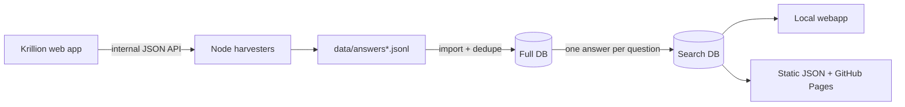

# Krillion Answer Database

> Every graded answer from every Krillion prompt, collected into a fast, searchable database.

[](#progress)
[](https://www.python.org/)
[](https://www.sqlite.org/fts5.html)
[](https://berliandro.github.io/krillion-answer-database/)

This repo collects the graded answer bank behind [Krillion Unlimited](https://playdaily.org/krillion) — the daily game where a rare answer can be worth 100 points in a single round — and turns it into an instant search you can use mid-dive.

It started as a way to help a friend chase a high score. The scrape kept going, and the result is now a full archive of answers with a small, fast search index on top.

## Contents

- [Why this exists](#why-this-exists)
- [How it works](#how-it-works)
- [How the data was collected](#how-the-data-was-collected)
- [Tools used](#tools-used)
- [Repository layout](#repository-layout)
- [Run it locally](#run-it-locally)
- [Static site](#static-site)
- [Progress](#progress)
- [Roadmap](#roadmap)

## Why this exists

Krillion grades each answer into six tiers. The top tier, **One in a Krillion**, is worth 100 points, but those are the hardest answers to think of under a 25-second clock. Finding one in time is the difference between a round you lose and a round you win.

The public search page is a static snapshot, so it works on a phone with no server. The local webapp reads the live database instead.

## How it works

Two databases, deliberately kept separate:

| Store | Contains | Purpose |
| --- | --- | --- |
| Full DB | Every answer to every prompt, with tier and source | Completeness; the source of truth |
| Search DB | Exactly one answer per question | Speed; the only store the webapp reads |

The search DB prefers the "one in a krillion" answer for each question, then the shortest answer as a fallback. It is always rebuilt from the full DB, never edited by hand.



## How the data was collected

The answer banks are not in the page HTML. The process was reverse-engineered from the game itself:

1. Opened the game in Chrome and watched its network traffic and Next.js bundles.
2. Found the site's own JSON API and mapped the three endpoints it uses.
3. Measured the rate limit: a shared ~65-second window per deal, signaled by HTTP 425 with a `wait` value.
4. Found the burst pattern: probe one prompt, sleep `wait + 2s`, then request all seven prompts of that deal at once. Roughly 350 answers per cycle, about six times faster than pacing requests one by one.
5. Fixed the lap token. The game client round-trips a `lap` value on every deal; without it the server re-deals the same lap and dedupe drops climb. Persisting it restored seven fresh prompts per deal.
6. Appended every graded answer to append-only JSONL files. Import de-duplicates on `(question, answer)` and rebuilds the search DB.

### API endpoints

| Endpoint | Purpose |
| --- | --- |
| `POST /api/krillion/deal` | Deal seven prompts with one ticket each. Unthrottled. |
| `GET /api/krillion/answers?prompt=&ticket=` | Return the graded bank for one prompt. Rate limited: 425 means wait and retry. |
| `POST /api/krillion/answer` | Grade a single guess. Not used for bulk harvesting. |

### Answer tiers

| Tier | Label | Points |
| --- | --- | --- |
| 0 | Plankton | 10 |
| 1 | Too Clever | 15 |
| 2 | Schooler | 30 |
| 3 | Rare | 60 |
| 4 | Deep Cut | 85 |
| 5 | One in a Krillion | 100 |

Only tier 5 is marked `is_krillion: true` in the data.

## Tools used

| Tool | Role |
| --- | --- |
| OpenCode (Hy4 Flash Free) | The only AI assistant used. Built the databases, import pipeline, harvesters, webapp, and this repo. |
| In-app browser and `browse` MCP | Drove real Chrome to inspect the game, its network requests, and its JS bundles. |
| Node.js | Harvester scripts using plain `fetch`, with no cookies or headers required. |
| Python 3 and SQLite (FTS5) | Schema, import and de-duplication, and full-text search. |
| GitHub Pages | Hosts the static search site. |

## Repository layout

```text
.
├── data/
│   ├── answers.jsonl            # raw answers from the API harvester
│   ├── answers_gameplay.jsonl   # raw answers from the gameplay harvester
│   ├── krillion_full.db         # full DB (generated, gitignored)
│   ├── krillion_search.db       # small FTS5 search DB (generated, gitignored)
│   └── *-notes.md               # investigation notes
├── scripts/
│   ├── harvest.js               # paced API harvester
│   ├── harvest_game.js          # burst harvester (active)
│   ├── krillion_db.py           # init / import / rebuild / search / stats
│   └── build_static.py          # regenerates the Pages snapshot
├── webapp/
│   ├── app.py                   # local search server
│   └── index.html               # local UI
├── index.html                   # static Pages entry point
├── search-data.json             # static search snapshot
├── jobs.md                      # orchestration job tracker
└── AGENTS.md
```

## Run it locally

```powershell
python scripts/krillion_db.py init
python scripts/krillion_db.py import
python webapp/app.py
# open http://127.0.0.1:8765
```

Search a phrase with `python scripts/krillion_db.py search "fictional bear"`. The webapp searches only the small search DB; rebuild it at any time with `python scripts/krillion_db.py rebuild`.

## Static site

The public search lives at [berliandro.github.io/krillion-answer-database](https://berliandro.github.io/krillion-answer-database/). It is fully static: `index.html` loads `search-data.json` with a streaming progress bar, then searches entirely in the browser. No server required.

Because it is a snapshot, regenerate it after importing new answers:

```powershell
python scripts/build_static.py
git add index.html search-data.json
git commit -m "Refresh static search index"
git push
```

GitHub Pages rebuilds from `main`, usually within about a minute. The snapshot is small — roughly 60 KB today and around 155 KB (~52 KB gzipped) at the 3,000-question target — so it loads fine on a phone.

## Progress

Snapshot taken 2026-11-21. These numbers move as the harvesters run; this section will be refreshed when collection is complete.

| Metric | Count |
| --- | --- |
| Full answer rows | 57,496 |
| One in a Krillion answers | 8,338 |
| Questions collected | 1,170 |
| Target prompts | ~3,000 (the real bank may be closer to ~2,600) |

## Roadmap

- Harvest until the prompt bank is exhausted.
- Handle question looping so repeated prompts are recognized and de-duplicated instead of counted as new.
- Refresh this README with final counts once collection is complete.

## Note

Answers are sourced from the public Krillion game at [playdaily.org](https://playdaily.org/krillion). This project is unofficial and is not affiliated with Daily Games.
