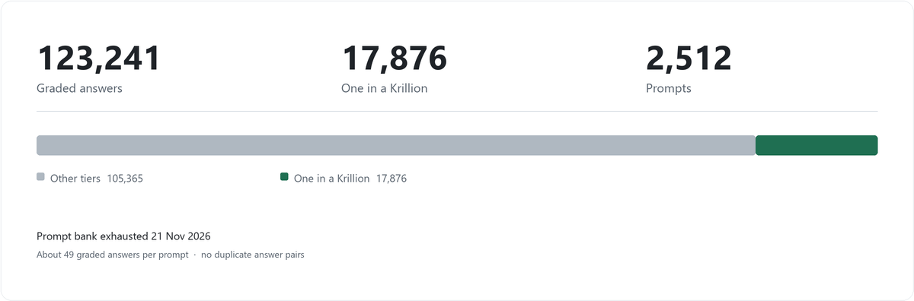

# Krillion Answer Database

> Complete archive of Krillion's graded answers, with instant search for the rare 100-point ones.

[](#final-tally)
[](https://berliandro.github.io/krillion-answer-database/)

This repo collects the graded answers from [Krillion Unlimited](https://playdaily.org/krillion) and makes them searchable while you play. Answers are graded across six tiers, from Plankton (10 points) to **One in a Krillion** (100 points); only the top tier is flagged `is_krillion: true`.

It started as a way to help a friend chase a high score. The scrape ran until the prompt bank was exhausted, and the result is a complete answer archive with a small, fast search index on top. Unofficial; not affiliated with Daily Games.


## Quick start

Use the [public search](https://berliandro.github.io/krillion-answer-database/) in a browser — no setup needed. To run it locally:

```powershell
python scripts/krillion_db.py init
python scripts/krillion_db.py import
python webapp/app.py
# open http://127.0.0.1:8765
```

Search with `python scripts/krillion_db.py search "fictional bear"`. Rebuild the Search DB with `python scripts/krillion_db.py rebuild`.

The public site is fully static: `index.html` loads `search-data.json` and searches in the browser. Regenerate the snapshot after importing answers:

```powershell
python scripts/build_static.py
git add index.html search-data.json
git commit -m "Refresh static search index"
git push
```

GitHub Pages rebuilds from `main` within about a minute. The snapshot is about 130 KB raw (~35 KB gzipped) at 2,509 questions.

## How it works

| Store | Contains | Purpose |
| --- | --- | --- |
| Full DB | Every answer to every prompt, with tier and source | Source of truth |
| Search DB | One answer per question | What the webapp reads |

The Search DB keeps the "One in a Krillion" answer when available, otherwise the shortest one. It is rebuilt from the Full DB after each import.

## How we collected the data

The answers are not in the page HTML. We found the game's own JSON API in its Next.js bundles and harvested it from Chrome:

1. Dealt prompts through `POST /api/krillion/deal` (seven prompts and one ticket each, unthrottled), then fetched each graded bank with `GET /api/krillion/answers`.
2. Handled the rate limit: HTTP 425 returns a `wait` value for a shared ~65-second window. Probing one prompt, sleeping `wait + 2s`, then fetching all seven in a burst yields about 350 answers per cycle, roughly six times faster than pacing requests.
3. Round-tripped the `lap` token on every deal so the server does not re-deal the same lap and pile up duplicates.
4. Appended every answer to JSONL files. Import removes duplicates by `(question, answer)` and rebuilds the Search DB.

`POST /api/krillion/answer` grades a single guess and was not used for bulk harvesting.

## Tools used

| Tool | Role |
| --- | --- |
| OpenCode (Hy4 Flash Free) | The only AI assistant used. Built the databases, import pipeline, harvesters, webapp, and this repo. |
| In-app browser and `browse` MCP | Inspected the game, its network requests, and its JS bundles in real Chrome. |
| Node.js | Harvesters using plain `fetch`, with no cookies or headers. |
| Python 3 and SQLite (FTS5) | Schema, import, de-duplication, and full-text search. |
| GitHub Pages | Hosts the static search site. |

## Repository layout

```text
data/       raw JSONL, Full DB, Search DB, notes
assets/     animated banner, static frame, final stats chart
scripts/    harvesters, krillion_db.py, build_static.py
webapp/     local search server and UI
index.html, search-data.json   static Pages site
jobs.md, AGENTS.md             job tracker and project rules
```

## Final tally



| Metric | Final count |
| --- | --- |
| Graded answers | 123,241 |
| One in a Krillion answers | 17,876 |
| Prompts | 2,512 |
| Duplicate answer pairs | 0 |

The estimate was around 3,000 prompts; the game's bank held 2,512, and all of them were captured. The final 60+ harvest batches dealt only prompts already in the archive.

## The end

The harvest stopped on 21 Nov 2026, when the game ran out of new prompts. The databases were rebuilt from the JSONL source and the static search site was published. Both the [public search](https://berliandro.github.io/krillion-answer-database/) and the local webapp remain live.

The dive is over. The answers remain.

## Credits

Animated pixel art: [Underwater Fantasy Pixel Art Environment](https://ansimuz.itch.io/underwater-fantasy-pixel-art-environment) by ansimuz, CC BY 4.0. A [static frame](assets/krillion-underwater.png) is provided for renderers that don't animate GIFs.
